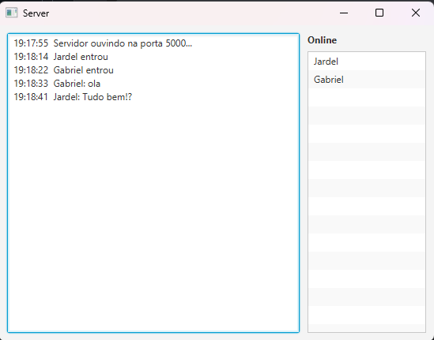
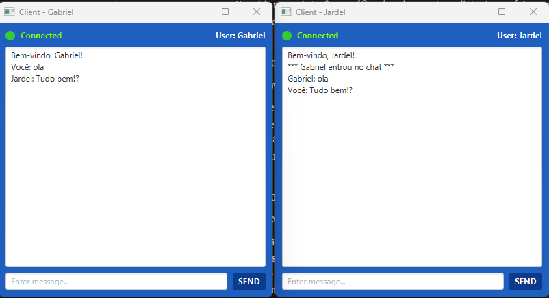

# ChatEmJava 💬

Aplicativo de chat em grupo feito em **Java**, com **Sockets**, **Threads** e interface gráfica em **JavaFX**. Projeto desenvolvido para a faculdade, construído em etapas para aprender redes, multi-threading e programação orientada a eventos.

## 📸 Telas

### Servidor com a lista de usuários conectados

### Clientes conversando

## ✨ Funcionalidades

- Chat em grupo com vários usuários ao mesmo tempo
- Apelido (nickname) escolhido ao entrar
- Avisos de quando alguém entra ou sai do chat
- Servidor com interface gráfica: log de eventos e lista de usuários online
- Indicador de status do cliente (conectado / desconectado)

## 🚀 Como rodar

Requisitos: **Java 17+** e **Maven** (o IntelliJ já traz o Maven embutido).

1. Execute a classe `LauncherServidor` para abrir o servidor.
2. Execute a classe `Launcher` para abrir um cliente. Repita para simular vários usuários (no IntelliJ, ative *Allow multiple instances* na configuração de execução).
3. Digite um apelido em cada cliente e converse.

## 🛠️ Como foi feito

O projeto foi construído em etapas, sempre testando cada parte antes de avançar:

1. **Sockets:** primeiro servidor e cliente de console, com um único cliente.
2. **Threads:** uma thread por cliente (`ClienteHandler`), para o servidor atender várias pessoas ao mesmo tempo.
3. **Chat em grupo:** lista compartilhada de clientes conectados, para repassar cada mensagem aos outros.
4. **Interface JavaFX:** cliente gráfico com área de mensagens, campo de texto e botão de envio.
5. **Apelidos:** a primeira linha enviada pelo cliente é o apelido (um protocolo simples de texto).
6. **Servidor gráfico:** a interface é separada da lógica por meio de uma interface de eventos (`OuvinteServidor`).

### Estrutura

| Classe | Função |
|---|---|
| `LauncherServidor` / `ServidorFX` | Abre o servidor e mostra log e usuários online |
| `ClienteHandler` | Atende um cliente (uma thread por conexão) e repassa as mensagens |
| `OuvinteServidor` | Interface de eventos: entrou, saiu, mensagem |
| `Launcher` / `ClienteFX` | Abre a janela do cliente e conecta ao servidor |

## 📚 O que aprendi

- **Sockets:** como dois programas conversam pela rede usando `ServerSocket` e `Socket`.
- **Multi-threading:** por que o servidor trava sem threads e como uma thread por cliente resolve.
- **Concorrência:** uso de coleções seguras para threads (`CopyOnWriteArrayList`) quando várias threads mexem na mesma lista.
- **JavaFX:** layouts (`VBox`, `HBox`, `BorderPane`), componentes e estilização com CSS.
- **Thread da interface:** só ela pode alterar a tela, então as outras threads usam `Platform.runLater`.
- **Programação orientada a eventos:** callbacks com interfaces para separar a lógica da tela.
- **Maven:** gerenciar dependências (JavaFX) pelo `pom.xml`.
- **Depuração:** ler mensagens de erro, achar código antigo misturado com o novo e testar cada etapa isoladamente.
- **Git/GitHub:** organizar o projeto, usar `.gitignore` e versionar o código.
---

Feito por **Jardel** 👨‍💻
